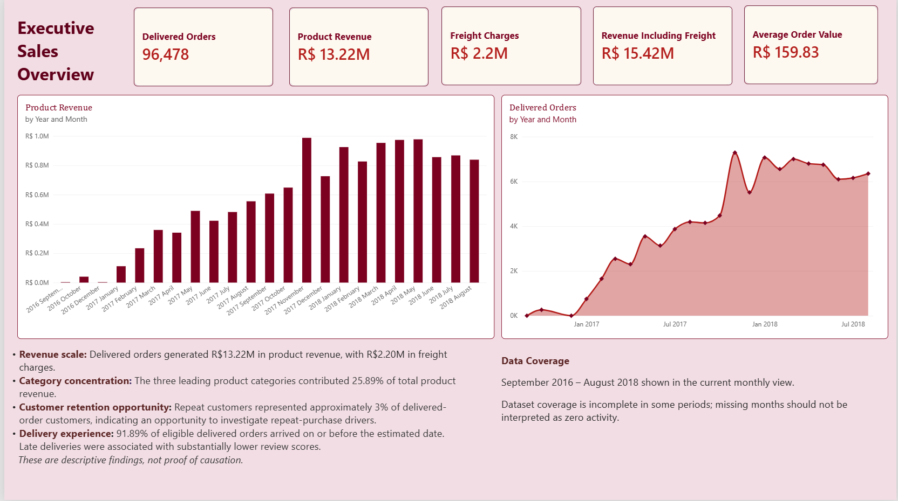
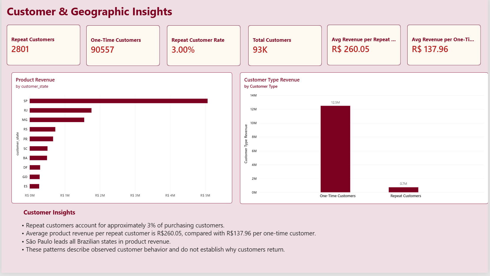
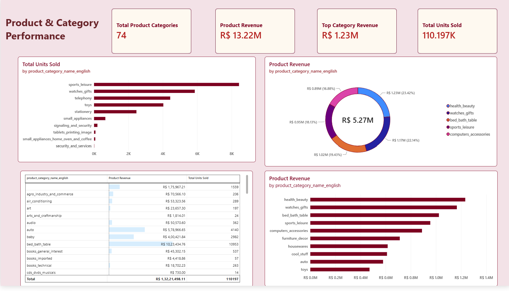
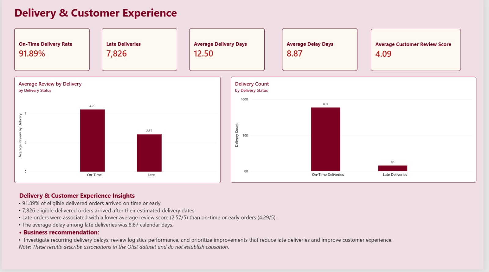

# E-Commerce Business Analytics & Customer Intelligence

**An end-to-end business intelligence project using MySQL, SQL, Power BI, and DAX to analyze e-commerce performance, customer behavior, product categories, geographic revenue, delivery operations, and customer satisfaction.**


---

## 1. Project Overview

E-commerce businesses need reliable reporting to understand sales performance, identify valuable product categories, retain customers, and improve delivery operations.

This project analyzes the Brazilian Olist e-commerce dataset to investigate these business questions using MySQL, SQL, and Power BI. The workflow combines relational database analysis, data validation, KPI development, and an interactive four-page Power BI dashboard.

The project goes beyond visualizing data by translating analytical findings into business interpretations, recommendations, and documented limitations.

**Project focus:** Business Analytics, Customer Intelligence, Sales Performance, Product Analysis, and Operational Performance.

## 2. Business Problem

The project investigates five major business areas:

- **Sales Performance:** How much product revenue was generated? How did sales change over time? What were the freight charges?
- **Product Performance:** Which product categories generated the highest revenue? Did the highest-revenue categories also lead in units sold?
- **Customer Intelligence:** How common was repeat purchasing? How did customer value differ between repeat and one-time customers?
- **Geographic Performance:** Which Brazilian states generated the highest product revenue?
- **Delivery & Customer Experience:** How reliably were orders delivered? How did customer review scores differ between on-time and late deliveries?

The objective was to convert these business questions into measurable KPIs, reproducible SQL queries, interactive Power BI dashboards, and actionable business recommendations.

## 3. Tools & Technologies

| Technology | Application in the Project |
|---|---|
| MySQL | Relational database management and SQL analysis |
| SQL | Joins, aggregations, filtering, grouping, KPI calculations, and business analysis |
| Power BI Desktop | Interactive four-page business intelligence dashboard |
| DAX | Measures for sales, customer behavior, delivery performance, and review scores |
| Power Query | Importing and preparing dataset files |
| Git & GitHub | Version control and project portfolio management |
| Markdown | Project documentation and reporting |

## 4. Dataset

The project uses the **Brazilian Olist E-Commerce Public Dataset**, which contains information about customers, orders, products, sellers, payments, reviews, and geographic locations.

The dataset consists of nine related CSV files:

| Dataset | Description |
|---|---|
| `olist_customers_dataset.csv` | Customer information and location |
| `olist_orders_dataset.csv` | Order details and order timestamps |
| `olist_order_items_dataset.csv` | Products purchased within each order |
| `olist_order_payments_dataset.csv` | Payment methods and payment amounts |
| `olist_order_reviews_dataset.csv` | Customer ratings and review information |
| `olist_products_dataset.csv` | Product attributes and category information |
| `olist_sellers_dataset.csv` | Seller information and location |
| `olist_geolocation_dataset.csv` | Brazilian geographic information |
| `product_category_name_translation.csv` | Product category name translations |

**Data considerations:**

- The dataset contains historical e-commerce activity rather than current market data.
- Some time periods have incomplete coverage.
- Delivery analysis requires valid actual and estimated delivery dates.
- Customer analysis uses `customer_unique_id` to identify customers consistently.
- Review-score comparisons are observational and do not establish causation.

The original CSV files are maintained in the `data/raw/` directory.

## 5. Power BI Dashboard

The project includes a single interactive Power BI report containing four analytical pages.

### Page 1 — Executive Sales Overview



**Business purpose:** Provide an overall view of sales performance, revenue generation, freight charges, and monthly trends.

**Key metrics:**

- Delivered Orders: 96,478
- Product Revenue: R$13.22M
- Freight Charges: R$2.20M
- Revenue Including Freight: R$15.42M
- Average Order Value: R$159.83

**Analysis:**

- Monthly product revenue trends
- Monthly delivered-order trends
- Revenue and freight contribution
- Executive business insights
- Historical data coverage observations

### Page 2 — Customer & Geographic Insights



**Business purpose:** Understand repeat purchasing, customer value, and geographic revenue distribution.

**Key metrics:**

- Repeat Customers: 2,801
- One-Time Customers: 90,557
- Repeat Customer Rate: 3.00%
- Total Purchasing Customers: 93,358
- Average Revenue per Repeat Customer: R$260.05
- Average Revenue per One-Time Customer: R$137.96

**Analysis:**

- Top Brazilian states by product revenue
- Repeat versus one-time customer comparison
- Customer purchasing behavior
- Geographic revenue distribution
- Customer retention opportunities

### Page 3 — Product & Category Performance



**Business purpose:** Identify high-performing product categories and compare revenue contribution with sales volume.

**Key metrics:**

- Product Revenue: R$13.22M
- Total Product Categories: 74
- Top Category Revenue: R$1.23M
- Total Units Sold: 110K
- Top Three Categories Revenue Share: 25.89%

**Analysis:**

- Top 10 product categories by revenue
- Top five categories by revenue contribution
- Detailed category revenue comparison
- Top categories by units sold
- Revenue concentration across categories

### Page 4 — Delivery & Customer Experience



**Business purpose:** Evaluate delivery reliability and investigate the relationship between delivery performance and customer satisfaction.

**Key metrics:**

- On-Time / Early Delivery Rate: 91.89%
- Late Deliveries: 7,826
- Average Delivery Time: 12.50 days
- Average Delay Among Late Deliveries: 8.87 days
- Average Customer Review Score: 4.09 / 5

**Analysis:**

- On-time versus late deliveries
- Average review scores for on-time and late deliveries
- Delivery performance comparison
- Customer satisfaction analysis
- Operational insights and business recommendations

**Key findings:**

- 91.89% of eligible delivered orders arrived on time or early.
- 7,826 eligible delivered orders arrived after their estimated delivery dates.
- Late orders had an average review score of 2.57/5, compared with 4.29/5 for on-time or early orders.
- The average delay among late deliveries was 8.87 calendar days.

**Business recommendation:** Investigate recurring delivery delays, review logistics performance, and prioritize improvements that reduce late deliveries and improve customer experience.

*Note: These results describe associations in the Olist dataset and do not establish causation.*

## 6. Key Business Findings

The following findings are based on the completed SQL analysis and Power BI report.

### Overall Sales Performance

| Metric | Result |
|---|---:|
| Total Orders | 99,441 |
| Delivered Orders | 96,478 |
| Delivered Order Items | 110,197 |
| Product Revenue | R$13,221,498.11 |
| Freight Charges | R$2,198,275.64 |
| Revenue Including Freight | R$15,419,773.75 |
| Average Order Value, Including Freight | R$159.83 |

**Business interpretation:**

The delivered orders generated approximately R$13.22 million in product revenue and R$2.20 million in freight charges. Freight represented approximately 14.26% of the combined revenue and freight total.

### Product & Category Performance

| Finding | Result |
|---|---:|
| Total Product Categories | 74 |
| Highest Revenue Category | Health & Beauty |
| Health & Beauty Revenue | R$1,233,131.72 |
| Highest Units Sold Category | Bed Bath & Table |
| Bed Bath & Table Units Sold | 10,953 |
| Top Three Categories Revenue Share | 25.89% |
| Top Five Categories Revenue Share | 39.83% |

**Business interpretation:**

Health & Beauty generated the highest product revenue, while Bed Bath & Table recorded the highest number of units sold. Revenue and sales volume therefore provide different perspectives when evaluating category performance.

### Customer Intelligence

| Metric | Result |
|---|---:|
| Total Purchasing Customers | 93,358 |
| One-Time Customers | 90,557 |
| Repeat Customers | 2,801 |
| Repeat Customer Rate | Approximately 3.00% |
| Average Revenue per One-Time Customer | R$137.96 |
| Average Revenue per Repeat Customer | R$260.05 |

**Business interpretation:**

Repeat customers represented approximately 3% of purchasing customers. Average product revenue per repeat customer was approximately 1.88 times the average for one-time customers.

This indicates an opportunity to investigate customer retention and repeat-purchase behavior.

### Geographic Performance

| State | Customers |
|---|---:|
| São Paulo (SP) | 39,156 |
| Rio de Janeiro (RJ) | 11,917 |
| Minas Gerais (MG) | 11,001 |

**Business interpretation:**

The three leading states represented approximately 66.48% of purchasing customers. São Paulo had the largest customer concentration and generated the highest state-level product revenue.

### Delivery & Customer Experience

| Metric | Result |
|---|---:|
| Eligible Delivered Orders | 96,470 |
| On-Time / Early Deliveries | 88,644 |
| Late Deliveries | 7,826 |
| On-Time / Early Delivery Rate | 91.89% |
| Late Delivery Rate | 8.11% |
| Average Delivery Time | 12.50 days |
| Average Delay Among Late Deliveries | 8.87 days |
| Average Review Score | 4.09 / 5 |

**Review score comparison:**

| Delivery Group | Average Review Score |
|---|---:|
| On-Time / Early Deliveries | 4.29 / 5 |
| Late Deliveries | 2.57 / 5 |

**Business interpretation:**

Late deliveries were associated with substantially lower average review scores. This highlights delivery reliability as an important area for further operational investigation. The analysis does not establish that delivery delays alone caused lower ratings.

## 7. Challenges & Solutions

The project involved several data, database, analytical, and reporting challenges.

### Challenge 1 — Working with Multiple Related Datasets

**Problem:** The source data was distributed across multiple CSV files representing different business entities.

**Approach:** Organized the datasets in MySQL and separated the SQL analysis into nine business-focused files. Used appropriate relationships and aggregation logic for each analytical task.

**Outcome:** The analysis became easier to organize, validate, review, and maintain.

### Challenge 2 — Preparing the Power BI Data Model

**Problem:** The report required multiple related tables to support customer, product, order, payment, seller, and review analysis.

**Approach:** Imported the source tables through Power Query and configured relationships between relevant business entities. The geolocation table was intentionally left disconnected because ZIP-code prefixes were not unique enough to support a reliable direct relationship.

**Outcome:** The report could use the required business relationships while avoiding an unreliable geolocation relationship.

### Challenge 3 — Defining Business KPIs Consistently

**Problem:** Metrics such as delivered orders, repeat customers, revenue per customer, and on-time delivery require precise definitions.

**Approach:** Created DAX measures around the project's business definitions and compared key results against the SQL analysis.

**Outcome:** Important metrics could be validated against established SQL findings instead of relying only on dashboard calculations.

### Challenge 4 — Identifying Repeat Customers

**Problem:** Customer records and customer identities are not necessarily equivalent. Counting every customer record as a distinct person can misrepresent repeat purchasing.

**Approach:** Used `customer_unique_id` for customer-level analysis and classified customers according to their purchasing behavior.

**Outcome:** Customer counts, repeat-purchase rates, and average revenue per customer could be compared using a consistent definition.

### Challenge 5 — Handling Incomplete Time Coverage

**Problem:** Some periods in the historical dataset have incomplete coverage. Missing months cannot automatically be interpreted as zero sales or zero orders.

**Approach:** Documented the data-coverage limitation in the dashboard and warned users against interpreting missing months as zero activity.

**Outcome:** Monthly trends are presented with an explicit historical coverage limitation.

### Challenge 6 — Interpreting Delivery Performance and Review Scores

**Problem:** Differences between review scores for late and on-time deliveries can be informative but do not prove a causal relationship.

**Approach:** Compared average review scores between the two delivery groups and documented the results as an association.

**Outcome:** The report provides a useful operational signal without overstating what descriptive analysis can establish.

### Open Validation Item — Product-Only Average Revenue per Order

The dashboard displays an average order value of R$159.83 when product revenue and freight are included.

A separate product-only calculation gives:

R$13,221,498.11 ÷ 96,478 delivered orders ≈ R$136.99.

The Power BI report previously displayed R$137.04 for the product-only measure. That difference remains an open reconciliation item and should be checked before treating the product-only figure as fully validated.

## 8. SQL Analysis Structure

The SQL business analysis is organized into separate files.

| SQL File | Analysis |
|---|---|
| `01_sales_performance.sql` | Overall sales performance and KPIs |
| `02_monthly_yearly_sales_trends.sql` | Monthly and yearly sales trends |
| `03_product_category_analysis.sql` | Product and category performance |
| `04_customer_analysis.sql` | Customer purchasing behavior |
| `05_geographic_analysis.sql` | Geographic revenue analysis |
| `06_payment_analysis.sql` | Payment methods and payment behavior |
| `07_delivery_performance.sql` | Delivery performance |
| `08_review_analysis.sql` | Customer review analysis |
| `09_order_status_analysis.sql` | Order statuses and operational outcomes |

**Supporting SQL files:**

- `database_setup.sql` — Database setup.
- `data_quality_checks.sql` — Data validation and quality checks.

The SQL analysis is supported by separate documentation covering methodology, business findings, validation, and data quality.

## 9. Repository Structure

The repository is organized into datasets, documentation, Power BI files, and SQL analysis scripts.

```text
ecommerce_business_analytics/
│
├── data/
│   └── raw/
│       ├── product_category_name_translation.csv
│       ├── olist_sellers_dataset.csv
│       ├── olist_products_dataset.csv
│       ├── olist_orders_dataset.csv
│       ├── olist_order_reviews_dataset.csv
│       ├── olist_order_payments_dataset.csv
│       ├── olist_order_items_dataset.csv
│       ├── olist_geolocation_dataset.csv
│       └── olist_customers_dataset.csv
│
├── documentation/
│   ├── 01_project_documentation/
│   ├── 02_sql_documentation/
│   └── 03_power_bi_documentation/
│
├── power_bi/
│   ├── screenshots/
│   │   ├── 01_executive_sales_overview.png
│   │   ├── 02_product_category_performance.png
│   │   ├── 03_customer_geographic_insights.png
│   │   └── 04_delivery_customers_experience.png
│   │
│   └── ecommerce_business_analytics.pbix
│
├── sql/
│   ├── business_analysis/
│   │   ├── 01_sales_performance.sql
│   │   ├── 02_monthly_yearly_sales_trends.sql
│   │   ├── 03_product_category_analysis.sql
│   │   ├── 04_customer_analysis.sql
│   │   ├── 05_geographic_analysis.sql
│   │   ├── 06_payment_analysis.sql
│   │   ├── 07_delivery_performance.sql
│   │   ├── 08_review_analysis.sql
│   │   └── 09_order_status_analysis.sql
│   │
│   ├── data_quality_checks.sql
│   └── database_setup.sql
│
├── README.md
└── .gitignore
```

## 10. How to Run the Project

### Prerequisites

- MySQL Server
- MySQL Workbench or another MySQL client
- Power BI Desktop
- Brazilian Olist dataset CSV files

### Setup and Analysis

1. Clone or download this repository.
2. Open MySQL Workbench and connect to your MySQL Server.
3. Review and execute `sql/database_setup.sql`.
4. Import the nine CSV files from `data/raw/` into the corresponding database tables.
5. Execute the SQL analysis files located in `sql/business_analysis/`.
6. Run `sql/data_quality_checks.sql` to review data quality.
7. Open `power_bi/ecommerce_business_analytics.pbix` in Power BI Desktop.
8. Update data-source paths or credentials if required.
9. Refresh the Power BI report.
10. Explore the four dashboard pages and review the supporting documentation.

**Note:** The PBIX file contains the interactive report. The PNG files in `power_bi/screenshots/` provide static dashboard previews for GitHub.

## 11. Business Recommendations

Based on the descriptive analysis, the following recommendations can support further business investigation:

- **Improve Customer Retention:** Investigate repeat-purchase behavior and develop strategies to encourage customers to purchase again.
- **Monitor Product Category Performance:** Evaluate revenue and units sold together when prioritizing product categories.
- **Focus on Geographic Opportunities:** Explore regional demand, customer concentration, and logistics requirements in high-revenue states.
- **Improve Delivery Reliability:** Investigate recurring causes of late deliveries and assess logistics performance.
- **Monitor Customer Satisfaction:** Track customer review scores alongside delivery performance metrics.
- **Maintain Data Quality:** Continue validating business definitions, relationships, and KPI calculations before using the metrics for operational decisions.

These recommendations are starting points for further investigation, not claims that a specific intervention has already been proven to work.

## 12. Limitations

- The dataset represents historical activity and should not be treated as a current market snapshot.
- Some time periods have incomplete coverage.
- Customer and repeat-purchase metrics depend on the project's customer identifier and classification rules.
- Delivery analysis excludes records without the required delivery dates.
- Review-score differences are observational and do not establish causation.
- The product-only average revenue per order has an open reconciliation item.
- Product revenue and freight-inclusive revenue are different measures and must be interpreted separately.
- The analysis is descriptive and does not establish causal relationships.

## 13. Project Documentation

Detailed supporting documentation is available in the following directories:

- `documentation/01_project_documentation/` — Project overview, key findings, and business recommendations.
- `documentation/02_sql_documentation/` — SQL methodology, business analysis findings, validation, and data quality.
- `documentation/03_power_bi_documentation/` — Power BI report structure, KPIs, and dashboard documentation.

These documents provide additional details about the project's analytical process and implementation.

## 14. Conclusion

This project demonstrates an end-to-end business analytics workflow using MySQL, SQL, Power BI, and DAX.

It covers relational data analysis, business KPI development, customer intelligence, product category performance, geographic revenue analysis, delivery operations, and customer satisfaction.

By combining SQL-based analysis with an interactive Power BI dashboard, the project translates raw e-commerce data into meaningful business findings and actionable recommendations.

The emphasis is on reproducible analysis, reliable KPI definitions, business relevance, and responsible interpretation of data.

---

*Developed as a portfolio project to demonstrate SQL-based business analysis, relational data analysis, Power BI reporting, KPI development, and business insight communication.*